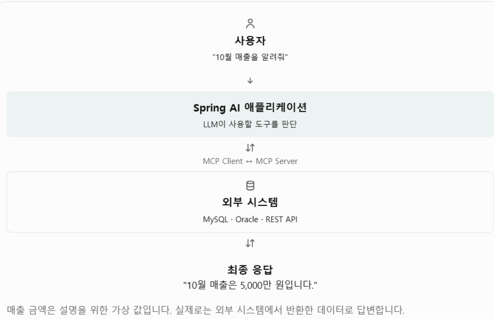

## 1. MCP란?

**MCP(Model Context Protocol)**는 AI 애플리케이션이 외부 도구와 데이터에 연결할 수 있도록 만든 표준 프로토콜이다.

일반적인 LLM은 회사 내부 데이터베이스나 외부 시스템에 직접 접근할 수 없다. MCP를 사용하면 외부 기능을 제공하는 MCP Server와 연결하여 필요한 데이터를 조회하거나 작업을 실행할 수 있다.

예를 들어 다음과 같은 질문을 생각해 보자.

> 우리 회사의 10월 매출을 조회하고 지난달과 비교해 줘.

일반적인 LLM은 회사 내부 데이터베이스에 접근할 수 없지만, 매출 조회 기능을 제공하는 MCP Server와 연결되어 있다면 해당 기능을 활용할 수 있다.

처리 흐름은 다음과 같다.

```text
사용자 질문
    ↓
AI 애플리케이션 (MCP Host)
    ↓
MCP Client
    ↓
MCP Server
    ↓
매출 데이터베이스 조회
    ↓
조회 결과 반환
    ↓
LLM이 결과 분석 및 답변
```

## 2. MCP의 주요 구성 요소

MCP는 Host, Client, Server를 중심으로 동작하며, Server는 Tool, Resource, Prompt 등의 기능을 제공할 수 있다.

| 구성 요소 | 역할 | 예시 |
|---|---|---|
| MCP Host | AI 애플리케이션이 실행되는 환경 | Spring AI 애플리케이션 |
| MCP Client | MCP Server와 통신하는 클라이언트 | Spring AI MCP Client |
| MCP Server | 외부 기능과 데이터를 제공 | 매출 조회 서버 |
| Tool | 실행 가능한 기능 제공 | `getSales()` |
| Resource | 읽을 수 있는 정보 제공 | 문서, 설정 데이터 |
| Prompt | 재사용 가능한 프롬프트 템플릿 제공 | 매출 분석 지침 |

### MCP Host

MCP Client를 관리하고 사용자와 상호작용하는 AI 애플리케이션이다.

예를 들어 Spring AI를 이용해 만든 AI 챗봇이 Host가 될 수 있다.

### MCP Client

MCP Server와 연결하고 요청 및 응답을 주고받는 역할을 한다.

하나의 Host는 여러 MCP Client를 통해 여러 MCP Server와 연결할 수 있다.

### MCP Server

외부 시스템의 기능과 데이터를 MCP 규격에 맞게 제공하는 서버다.

예를 들어 다음과 같은 기능을 제공할 수 있다.

- 사내 데이터베이스 조회
- 파일 검색
- 외부 API 호출
- GitHub 이슈 조회




### Tool, Resource, Prompt

| 구분 | 설명 | 예시 |
|---|---|---|
| Tool | 실행할 수 있는 기능 | 매출 조회, 주문 취소 |
| Resource | 읽을 수 있는 데이터 | 사내 문서, 설정 파일 |
| Prompt | 재사용 가능한 프롬프트 | 보고서 작성 지침 |

## 3. MCP와 일반적인 Tool Calling의 차이

Tool Calling은 LLM이 필요한 도구를 선택하고 호출하는 메커니즘이다.

MCP는 외부 도구와 데이터를 표준화된 방식으로 연결하기 위한 프로토콜이다.

| 구분 | 일반 Tool Calling | MCP |
|---|---|---|
| 도구 정의 | 애플리케이션에서 직접 정의하는 경우가 많음 | MCP Server에서 제공 가능 |
| 도구 연결 | 개발자가 개별 연동 | 표준 프로토콜 사용 |
| 재사용성 | 애플리케이션에 종속되기 쉬움 | 여러 MCP Client에서 재사용 가능 |
| 예시 | Spring AI `@Tool` | Spring AI MCP Server |

**핵심 차이**

- Tool Calling: AI가 기능을 호출하는 방법
- MCP: AI 애플리케이션과 외부 기능을 연결하는 표준 규격

MCP Server가 제공하는 Tool을 LLM이 호출하는 과정에서도 내부적으로 Tool Calling 메커니즘이 활용될 수 있다.

즉, MCP와 Tool Calling은 서로 대체하는 개념이 아니라 함께 사용할 수 있는 기술이다.

## 4. MCP 통신 방식

MCP는 실행 환경에 따라 서로 다른 통신 방식을 사용할 수 있다.

| 항목 | STDIO | Streamable HTTP |
|---|---|---|
| 통신 수단 | 표준 입출력 | HTTP 네트워크 통신 |
| 서버 실행 | 주로 Client가 별도 프로세스로 실행 | 독립적인 서버로 실행 가능 |
| 서버 주소 | 프로세스 실행 명령 | URL |
| 적합한 환경 | 로컬 도구 | 원격 서비스 |
| 실습 난이도 | 비교적 쉬움 | 네트워크 설정 등이 필요 |

> 참고: 과거 MCP에서는 HTTP + SSE 방식이 사용되었지만, 현재 표준 HTTP 전송 방식은 Streamable HTTP이다. 기존 HTTP + SSE 방식은 이전 버전과의 호환성을 위한 방식으로 이해하면 된다.

### STDIO

표준 입출력을 이용해 MCP Client와 MCP Server가 통신하는 방식이다.

주로 로컬 환경에서 도구를 실행할 때 사용한다.

### Streamable HTTP

HTTP를 이용해 네트워크를 통해 MCP Server와 통신하는 방식이다.

서버를 독립적으로 실행할 수 있기 때문에 원격 서비스나 여러 클라이언트가 공유하는 환경에 적합하다.

## 5. RAG와 Tool Calling의 차이

MCP와 함께 이해해야 할 개념으로 RAG와 Tool Calling이 있다.

### RAG (Retrieval-Augmented Generation)

RAG는 외부 문서를 검색하여 검색 결과를 LLM에 전달하고, 이를 바탕으로 더 정확한 답변을 생성하도록 하는 기술이다.

대표적으로 다음과 같은 데이터를 활용한다.

- PDF 문서
- 사내 규정
- 기술 문서
- 매뉴얼

Spring AI에서는 `VectorStore`, `QuestionAnswerAdvisor` 등을 활용해 RAG를 구현할 수 있다.

### Tool Calling

Tool Calling은 LLM이 필요하다고 판단할 때 Java 메서드나 외부 API 등의 도구를 호출하여 정보를 조회하거나 작업을 수행하는 기술이다.

대표적인 활용 사례는 다음과 같다.

- 주문 내역 조회
- 예약 등록
- 날씨 조회
- 데이터베이스 조회 및 수정

Spring AI에서는 `@Tool`, `.tools()` 등을 활용할 수 있다.

### 주요 차이점

| 구분 | RAG | Tool Calling |
|---|---|---|
| 주요 목적 | 지식 검색 및 답변 | 기능 실행 및 외부 시스템 연동 |
| 대표 데이터 | PDF, 사내 문서, 매뉴얼 | API, DB, Java 메서드 |
| LLM 역할 | 검색된 정보를 바탕으로 답변 | 도구 선택 및 인자 생성 |
| 실행 시점 | 일반적으로 LLM 답변 생성 전 검색 | LLM이 필요하다고 판단할 때 |
| 데이터 변경 | 일반적으로 없음 | 조회뿐 아니라 등록·수정 가능 |
| Spring AI | `VectorStore`, `QuestionAnswerAdvisor` | `@Tool`, `.tools()` |
| 활용 사례 | 사내 규정 Q&A | 주문 조회, 예약, 날씨 조회 |

## 6. RAG와 Tool Calling을 함께 사용하는 사례

사내 인사 AI 챗봇을 만든다고 가정해 보자.

사용자의 질문에 따라 RAG와 Tool Calling을 구분해서 사용할 수 있다.

| 사용자 질문 | 처리 방식 |
|---|---|
| 우리 회사 연차 규정은? | RAG로 규정 PDF 검색 |
| 내 남은 연차는? | Tool로 인사 DB 조회 |
| 내 연차 2일 신청해 줘 | Tool로 연차 신청 처리 |
| 연차 규정 확인하고 내 연차도 알려줘 | RAG + Tool |

### 전체 처리 흐름

```text
                 사용자 질문
                      ↓
                 LLM 질문 분석
                      ↓
             어떤 기능이 필요한가?
                      ↓
          ┌───────────┴───────────┐
          ↓                       ↓
      문서 검색                 기능 실행
          ↓                       ↓
         RAG                 Tool Calling
          ↓                       ↓
    연차 규정 검색          인사 DB 조회
          ↓                       ↓
          └───────────┬───────────┘
                      ↓
                LLM 결과 통합
                      ↓
                 최종 답변
```

예를 들어 사용자가 다음과 같이 질문할 수 있다.

> 우리 회사 연차 규정에 따르면 연차를 어떻게 신청해야 해? 그리고 내 남은 연차도 알려줘.

이 경우 다음과 같이 처리할 수 있다.

1. RAG로 사내 연차 규정 문서를 검색한다.
2. Tool Calling으로 인사 DB에서 사용자의 잔여 연차를 조회한다.
3. LLM이 두 결과를 종합하여 답변한다.

이처럼 RAG와 Tool Calling을 함께 사용하면 문서 기반 지식 검색과 실제 시스템의 데이터 조회 및 작업 처리를 하나의 AI 애플리케이션에서 구현할 수 있다.

## 7. 핵심 정리

| 기술 | 핵심 역할 | 비유 |
|---|---|---|
| RAG | 외부 지식을 검색하여 답변에 활용 | 자료를 찾아 읽기 |
| Tool Calling | 필요한 기능을 선택하고 실행 | 직접 업무 처리하기 |
| MCP | 외부 도구와 데이터를 표준 방식으로 연결 | 여러 도구를 연결하는 공통 규격 |

**정리하면 다음과 같다.**

- RAG는 AI가 외부 지식을 참고하도록 만든다.
- Tool Calling은 AI가 외부 기능을 실행하도록 만든다.
- MCP는 AI 애플리케이션이 외부 도구와 데이터를 표준화된 방식으로 연결하도록 만든다.

세 기술은 서로 경쟁하는 기술이 아니라 목적에 따라 함께 활용할 수 있다.