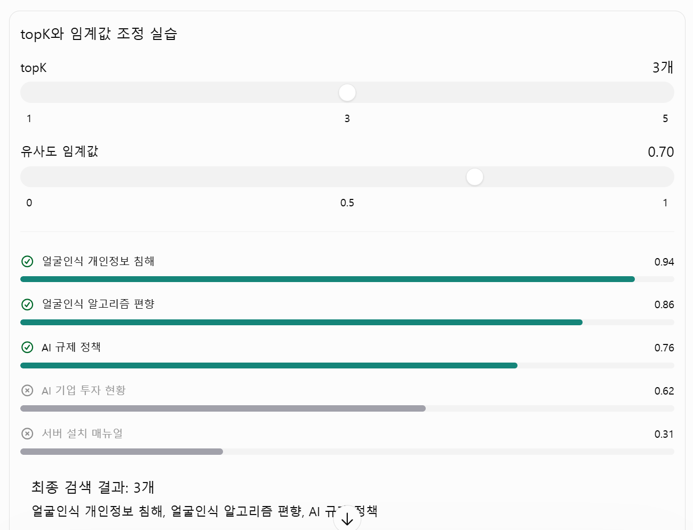

## 1. RAG에서 검색 품질이 중요한 이유

RAG(Retrieval-Augmented Generation)는 사용자의 질문과 관련된 문서를 벡터 데이터베이스에서 검색하고, 검색된 내용을 LLM에 전달하여 답변을 생성하는 방식이다.

RAG의 답변 품질은 LLM의 성능뿐만 아니라 **얼마나 적절한 문서를 검색했는지**에도 영향을 받는다.

예를 들어 사용자가 다음과 같이 질문했다고 가정하자.

```text
얼굴인식 기술의 문제점은 무엇인가요?
```

벡터 데이터베이스에는 다음과 같은 문서가 저장되어 있다.

- 얼굴인식 기술의 개인정보 침해 문제
- 얼굴인식 알고리즘의 편향 문제
- AI 규제 정책
- 이미지 파일 압축 방법
- 데이터베이스 인덱스 최적화

이때 질문과 관련성이 높은 문서를 검색해야 LLM이 정확한 답변을 생성할 수 있다.

Spring AI에서는 검색 결과를 조절하기 위해 대표적으로 다음 두 가지 설정을 사용한다.

- `topK`: 검색 결과를 최대 몇 개까지 가져올 것인가?
- `similarityThreshold`: 어느 정도의 유사도를 가진 문서까지 허용할 것인가?

---

## 2. topK란?

`topK`는 벡터 검색 결과 중 유사도가 높은 문서를 최대 몇 개까지 가져올지 결정하는 설정이다.

예를 들어 다음과 같이 설정할 수 있다.

```java
SearchRequest.builder()
    .query("얼굴인식 기술의 문제점은 무엇인가요?")
    .topK(5)
    .build();
```

위 코드는 질문과 유사도가 높은 문서를 최대 5개까지 검색한다.

### 2-1. topK 동작 방식

벡터 데이터베이스에 질문과 관련된 문서가 다음과 같이 저장되어 있다고 가정하자.

| 순위 | 문서 | 유사도 점수 |
|---|---|---:|
| 1 | 얼굴인식 개인정보 침해 | 0.95 |
| 2 | 얼굴인식 알고리즘 편향 | 0.89 |
| 3 | AI 규제 정책 | 0.82 |
| 4 | 생체인식 데이터 보안 | 0.76 |
| 5 | 이미지 처리 기술 | 0.65 |

`topK(3)`으로 설정하면 상위 3개 문서가 검색된다.

```text
topK(3)

1. 얼굴인식 개인정보 침해
2. 얼굴인식 알고리즘 편향
3. AI 규제 정책
```

즉, `topK`는 검색 결과의 최대 개수를 제한한다.

### 2-2. topK가 너무 작으면?

- 답변에 필요한 문서가 검색되지 않을 수 있다.
- 여러 문서에 분산된 정보를 종합하기 어렵다.
- LLM에 전달되는 문서량이 줄어 입력 토큰과 처리 시간이 감소할 수 있다.

### 2-3. topK가 너무 크면?

- 질문과 관련성이 낮은 문서까지 포함될 수 있다.
- LLM에 전달되는 입력 토큰이 증가한다.
- 불필요한 문서나 중복된 내용이 답변 생성에 영향을 줄 수 있다.

따라서 무조건 많은 문서를 가져오는 것이 좋은 것은 아니다.

---

## 3. similarityThreshold란?

`similarityThreshold`는 검색 결과에 포함할 문서의 최소 유사도 기준을 설정하는 값이다.

예를 들어 다음과 같이 설정한다.

```java
SearchRequest.builder()
    .query("얼굴인식 기술의 문제점은 무엇인가요?")
    .topK(5)
    .similarityThreshold(0.7)
    .build();
```

위 코드는 유사도 임계값을 `0.7`로 설정한다.

일반적인 유사도 점수 기준으로 설명하면 0.7 이상의 문서만 검색 결과에 포함한다.

### 3-1. similarityThreshold 동작 방식

다음과 같은 검색 결과가 있다고 가정하자.

| 순위 | 문서 | 유사도 점수 | 임계값 0.7 통과 |
|---|---|---:|---|
| 1 | 얼굴인식 개인정보 침해 | 0.95 | O |
| 2 | 얼굴인식 알고리즘 편향 | 0.89 | O |
| 3 | AI 규제 정책 | 0.82 | O |
| 4 | 생체인식 데이터 보안 | 0.76 | O |
| 5 | 이미지 처리 기술 | 0.65 | X |

`similarityThreshold(0.7)`을 적용하면 0.7 미만인 마지막 문서는 제외된다.

### 3-2. 임계값이 너무 높으면?

- 관련성이 있는 문서도 검색 결과에서 제외될 수 있다.
- 검색 결과가 0개가 될 수 있다.
- 답변에 필요한 정보가 충분하지 않을 수 있다.

### 3-3. 임계값이 너무 낮으면?

- 질문과 관련성이 낮은 문서도 포함될 수 있다.
- 불필요한 정보가 LLM에 전달된다.
- 답변의 정확성이 떨어질 가능성이 있다.

즉, 임계값은 검색 결과의 관련성을 어느 정도까지 허용할지 결정하는 기준이다.

---

## 4. topK와 similarityThreshold의 차이

두 설정은 검색 결과를 제한한다는 공통점이 있지만 역할은 다르다.

| 구분 | topK | similarityThreshold |
|---|---|---|
| 목적 | 검색 문서의 최대 개수 제한 | 검색 문서의 최소 유사도 제한 |
| 기준 | 문서 개수 | 유사도 점수 |
| 예시 | `topK(5)` | `similarityThreshold(0.7)` |
| 결과 | 최대 5개 | 임계값을 통과한 문서 |
| 너무 낮거나 작을 때 | 필요한 문서 누락 가능 | 관련 문서까지 제외될 수 있음 |

두 설정을 함께 사용하면 다음과 같다.

```java
SearchRequest.builder()
    .query(question)
    .topK(5)
    .similarityThreshold(0.7)
    .build();
```

- 유사도가 높은 순서대로 최대 5개를 검색한다.
- 유사도 임계값 0.7을 통과하지 못하는 문서는 제외한다.

따라서 최종 결과는 최대 5개이며 실제 결과는 0~5개가 될 수 있다.

단, 실제 검색 결과의 순서와 점수는 사용하는 벡터 데이터베이스의 검색 방식과 유사도 계산 기준에 따라 달라질 수 있다.

---

## 5. 실무에서는 어떻게 조정할까?

처음부터 완벽한 값을 정하려고 하기보다는 실제 질문을 이용해 반복적으로 테스트하는 것이 효율적이다.

다음은 실험을 시작하기 위한 설정 예시다.

| 단계 | topK | 임계값 | 목적 |
|---|---:|---:|---|
| 1차 테스트 | 5 | 0.0 | 검색되는 문서와 점수 확인 |
| 2차 테스트 | 5 | 0.6 | 관련 없는 문서 제거 여부 확인 |
| 3차 테스트 | 5 | 0.7 | 답변 품질 비교 |
| 4차 테스트 | 3 | 0.7 | 문서 수를 줄여도 답변이 충분한지 확인 |
| 5차 테스트 | 8 | 0.7 | 여러 청크가 필요한 질문에 대응 가능한지 확인 |

위 값은 실험을 위한 예시이며 모든 RAG 시스템에 동일하게 적용되는 정답은 아니다.

특히 `similarityThreshold(0.7)`이 항상 적절한 것은 아니다.

임베딩 모델, 벡터 데이터베이스, 거리 계산 방식에 따라 점수의 분포가 달라질 수 있기 때문이다.

---

## 6. Spring AI에서 검색 점수 확인하기

검색 설정을 조정하려면 실제로 어떤 문서가 검색되는지 확인해야 한다.

검색 결과의 문서 내용과 점수를 출력하면 어떤 문서가 질문과 관련성이 높은지 비교할 수 있다.

### 6-1. 검색 결과 조회

```java
List<Document> results =
    vectorStore.similaritySearch(
        SearchRequest.builder()
            .query("얼굴인식 기술의 문제점은?")
            .topK(10)
            .similarityThreshold(0.0)
            .build()
    );
```

여기서는 다음과 같이 설정했다.

- `topK(10)`: 최대 10개 문서 검색
- `similarityThreshold(0.0)`: 임계값을 낮춰 검색 결과 확인

### 6-2. 검색된 문서와 점수 출력

```java
for (Document doc : results) {
    System.out.println("점수: " + doc.getScore());
    System.out.println("내용: " + doc.getText());
    System.out.println("-------------------");
}
```

출력 예시:

```text
점수: 0.95
내용: 얼굴인식 기술은 개인정보 침해 문제를 발생시킬 수 있다.
-------------------

점수: 0.89
내용: 얼굴인식 알고리즘은 학습 데이터에 따라 편향이 발생할 수 있다.
-------------------

점수: 0.82
내용: AI 기술에 대한 규제와 정책이 필요하다.
-------------------
```

이렇게 검색 결과를 직접 확인하면 임계값을 어느 정도로 설정할지 판단하는 데 도움이 된다.

**참고:** `Document.getScore()`의 점수는 사용하는 Spring AI 버전과 VectorStore 구현에 따라 제공 여부 및 의미가 달라질 수 있다. 일부 구현에서는 유사도 점수가 아니라 거리 점수를 반환하거나 점수를 제공하지 않을 수 있으므로 실제 사용하는 VectorStore의 동작을 확인해야 한다.

---

## 7. 검색 품질과 LLM 답변 품질의 관계

RAG의 전체 처리 과정은 다음과 같다.

```text
사용자 질문
     │
     ▼
질문 임베딩 생성
     │
     ▼
벡터 데이터베이스 검색
     │
     ├── topK: 검색 문서 개수 제한
     │
     └── similarityThreshold: 유사도 기준 적용
     │
     ▼
최종 검색 문서
     │
     ▼
LLM에 질문과 검색 문서 전달
     │
     ▼
최종 답변 생성
```

여기서 중요한 점은 검색 결과가 좋다고 해서 반드시 답변 품질이 완벽해지는 것은 아니라는 것이다.

- 검색 문서가 질문과 관련이 있어야 한다.
- 검색 문서에 답변에 필요한 정보가 포함되어 있어야 한다.
- 문서가 중복되거나 서로 상충하는 경우도 고려해야 한다.
- LLM이 전달된 문서를 바탕으로 적절하게 답변해야 한다.

따라서 RAG의 품질을 개선하려면 검색 설정뿐 아니라 청크 분할, 임베딩 모델, 프롬프트, LLM 응답 생성 과정까지 함께 확인해야 한다.

---

## 8. 핵심 정리

| 항목 | 핵심 내용 |
|---|---|
| topK | 검색할 문서의 최대 개수 |
| similarityThreshold | 검색 결과에 포함할 최소 유사도 기준 |
| topK가 작을 때 | 필요한 문서가 누락될 수 있음 |
| topK가 클 때 | 불필요한 문서와 입력 토큰이 증가할 수 있음 |
| 임계값이 높을 때 | 관련 문서도 제외될 수 있음 |
| 임계값이 낮을 때 | 관련성이 낮은 문서가 포함될 수 있음 |

**결론**

`topK`는 검색 결과의 양을 조절하고, `similarityThreshold`는 검색 결과의 유사도 기준을 조절한다.

두 설정을 적절하게 조합하고 실제 검색 결과를 확인하면서 조정해야 RAG 시스템의 검색 품질과 LLM 답변 품질을 개선할 수 있다.

