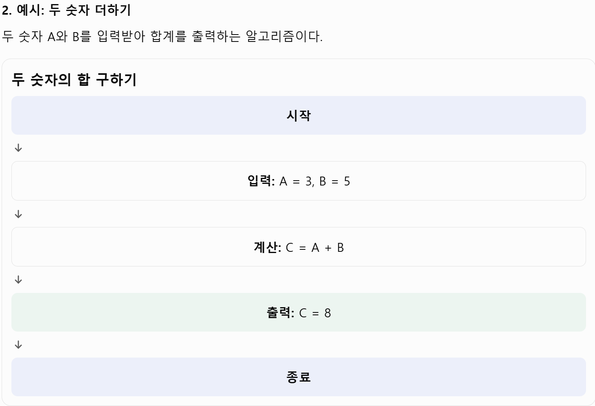
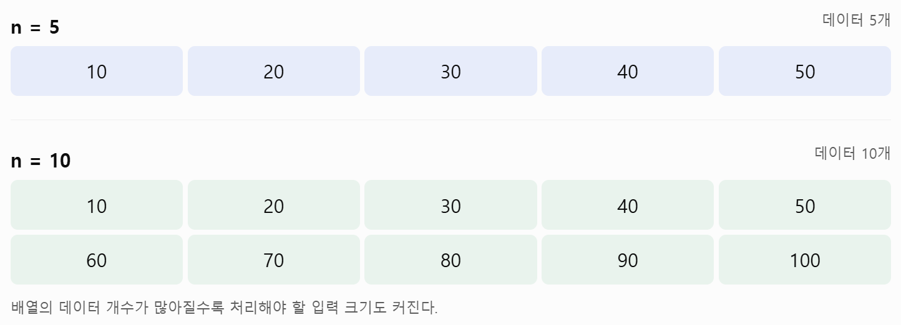
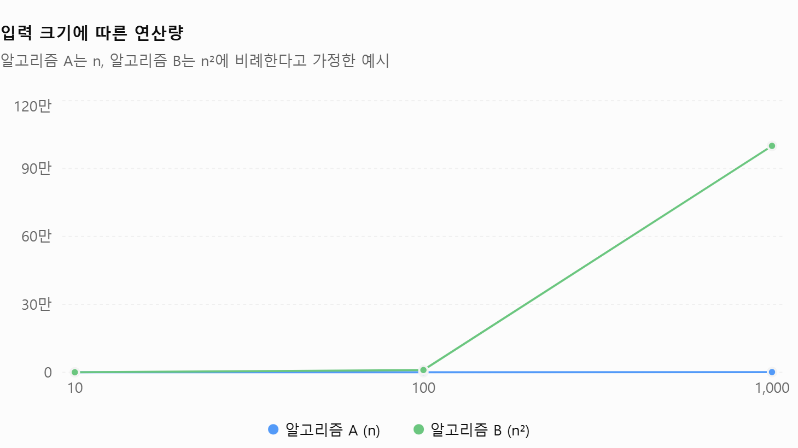
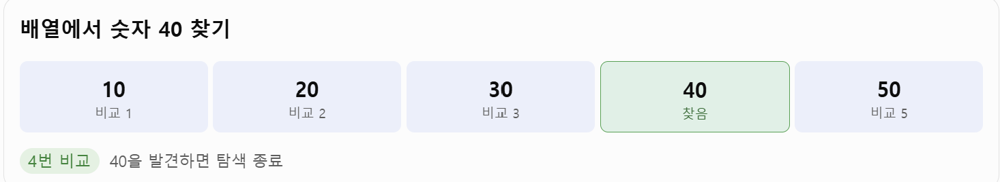
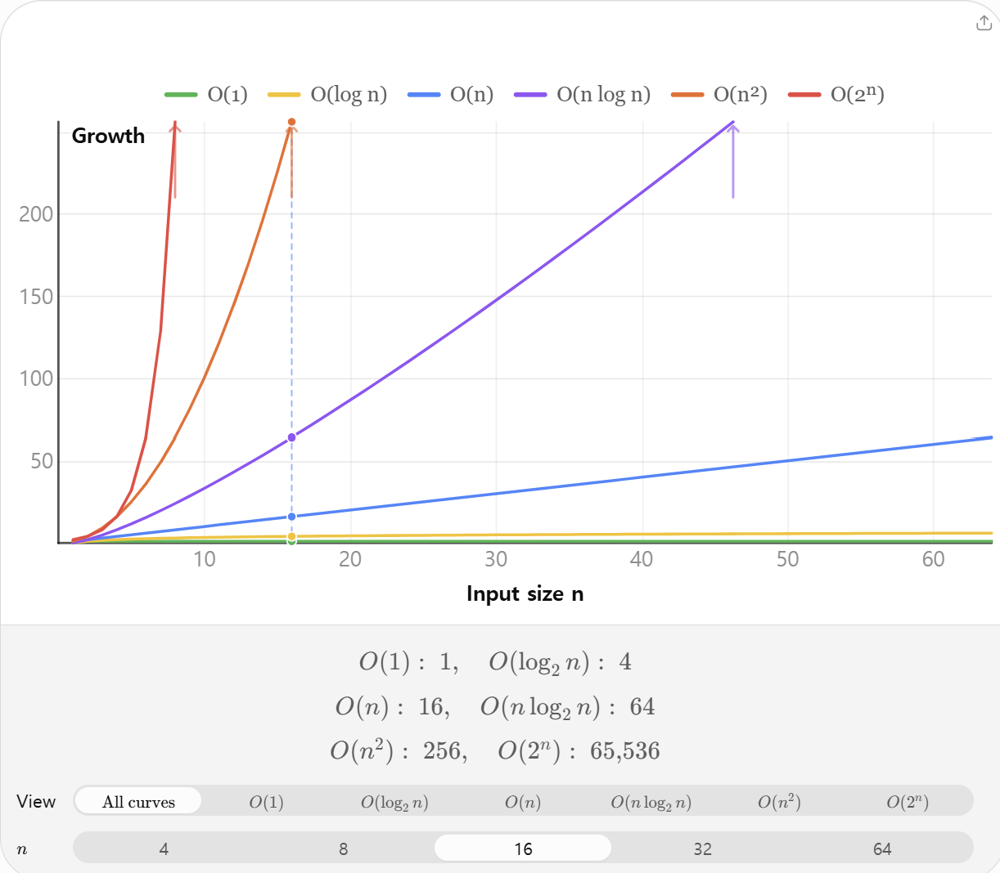
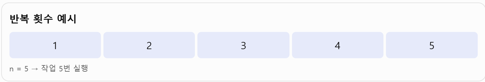
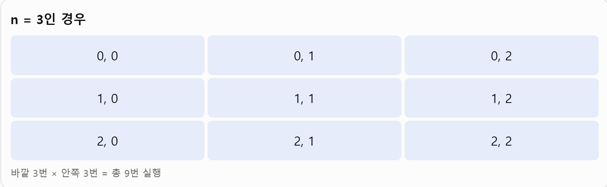
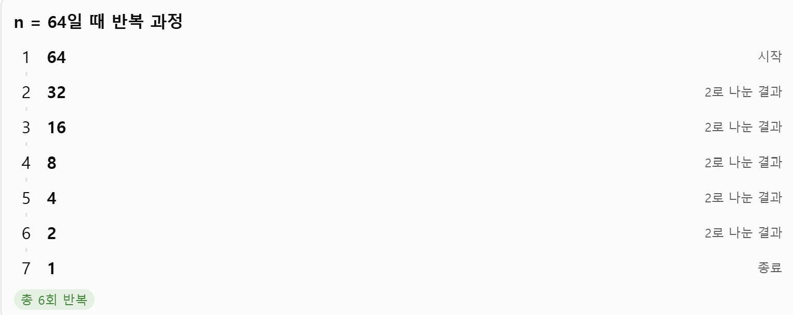
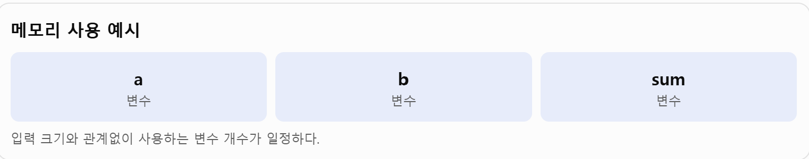
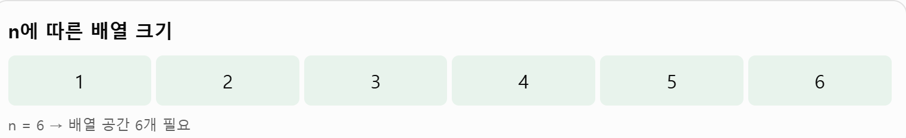

## 1.1 자료구조와 알고리즘

**자료구조(Data Structure)**는 데이터를 저장하고 정리하는 방법이다.  
**알고리즘(Algorithm)**은 주어진 문제를 해결하기 위한 단계별 절차다.

예를 들어, 연락처에서 이름을 찾는 문제를 생각해 보자.

- 연락처를 어떤 방식으로 저장할지 정하는 것은 **자료구조 선택**
- 저장된 연락처에서 이름을 찾는 절차를 정하는 것은 **알고리즘 설계**

자료구조와 알고리즘은 서로 영향을 준다. 데이터를 어떻게 정리하느냐에 따라 같은 작업에 필요한 절차와 시간이 달라질 수 있다.

자료구조를 고를 때는 다음을 살펴본다.

- 어떤 작업을 자주 하는가? (찾기, 추가, 삭제 등)
- 각 작업에 시간이 얼마나 걸리는가?
- 데이터를 저장하는 데 메모리가 얼마나 필요한가?
- 데이터의 순서를 유지해야 하는가?


## 1.2 알고리즘의 조건

알고리즘은 보통 다음 조건을 만족해야 한다.

- **입력**: 문제를 풀기 위해 필요한 값이 주어진다.
- **출력**: 문제의 답을 만들어 낸다.
- **명확성**: 각 단계가 모호하지 않다.
- **유한성**: 정해진 횟수 안에 끝난다.
- **효과성**: 각 단계를 실제로 수행할 수 있다.

알고리즘이 답을 빠르게 내더라도 답이 틀리면 좋은 알고리즘이 아니다. 따라서 알고리즘을 평가할 때는 **정확성**과 **효율성**을 함께 본다.



## 1.3 입력 크기

알고리즘의 효율성을 분석할 때는 보통 입력의 크기를 `n`으로 나타낸다.

예를 들어 숫자 `n`개가 담긴 배열이 주어지면 배열의 길이가 입력 크기다.

입력의 크기가 커질 때 연산량이 어떻게 증가하는지를 분석하면, 서로 다른 알고리즘의 효율을 비교할 수 있다.

**입력 크기에 따른 배열 예시**



**입력 크기와 연산량의 관계**
~~~
int[] numbers = {10, 20, 30, 40, 50};

for (int i = 0; i < numbers.length; i++) {
    System.out.println(numbers[i]);
}
~~~
- 배열의 길이가 5라면 반복문은 5번 실행된다.
- 배열의 길이가 100이라면 반복문은 100번 실행된다.
- 배열의 길이가 1,000이라면 반복문은 1,000번 실행된다.

**입력 크기를 분석하는 이유**
예를 들어 다음 두 알고리즘이 있다고 가정하자.

| 입력 크기 | 알고리즘 A (n번) | 알고리즘 B (n²번) |
| --- | --- | --- |
| 10  | 10  | 100 |
| 100 | 100 |10000|
| 1000| 1000|100000|



## 1.4 시간 복잡도

**시간 복잡도(Time Complexity)**는 입력 크기가 커질 때 알고리즘의 연산량이 어떻게 증가하는지를 나타낸다.

실제 실행 시간을 초 단위로 재는 대신, 연산 횟수의 증가 추세를 분석한다. 실행 시간은 컴퓨터 성능이나 프로그램 환경에 따라 달라질 수 있기 때문이다.

### 예시: 배열에서 값 찾기

길이가 `n`인 배열에서 특정 값을 찾는다고 하자.



탐색하는 위치에 따라 연산 횟수가 달라진다.
- 최선의 경우: 첫 번째 원소가 정답 → 1번 비교
- 최악의 경우: 마지막 원소에 정답이 있거나 값이 없음 → n번 비교
- 평균적인 경우: 대략 n/2번 비교 (성공하는 위치가 균등하다고 가정)

-------------------------------------------------------------------

- 첫 번째 원소부터 차례로 확인하면, 최악의 경우 `n`개를 모두 확인한다.
- 연산량은 입력 크기 `n`에 비례한다.
- 이 탐색의 시간 복잡도는 `O(n)`이다.

## 1.5 Big-O 표기법

**Big-O 표기법**은 입력 크기가 커질 때 알고리즘의 연산량이 어떤 속도로 증가하는지 나타내는 방법이다.

복잡도를 간단히 표현할 때는 상수 계수와 낮은 차수의 항을 생략한다.

```text
3n + 5       → O(n)
2n² + 4n + 1 → O(n²)
```

`n`이 충분히 커지면 가장 빠르게 증가하는 항이 전체 증가 추세를 좌우하기 때문이다.

### 자주 보는 시간 복잡도

| 복잡도 | 이름 | 예시 |
|---|---|---|
| `O(1)` | 상수 시간 | 배열의 특정 위치 읽기 |
| `O(log n)` | 로그 시간 | 정렬된 배열에서 이진 탐색 |
| `O(n)` | 선형 시간 | 배열 전체 훑기 |
| `O(n log n)` | 선형 로그 시간 | 효율적인 비교 정렬 |
| `O(n²)` | 이차 시간 | 배열의 모든 원소 쌍 비교 |
| `O(2ⁿ)` | 지수 시간 | 가능한 경우를 모두 조합해 확인하는 일부 문제 |
| `O(n!)` | 팩토리얼 시간 | 모든 순서를 하나씩 확인하는 경우 |



일반적으로 입력이 커질수록 `O(n)` 알고리즘은 `O(n²)` 알고리즘보다 유리하다.


## 1.6 반복문으로 복잡도 살펴보기

### 한 번 반복하는 경우

```text
for i = 1부터 n까지:
    작업
```

**예시**


작업이 약 `n`번 실행되므로 `O(n)`이다.

### 중첩 반복문

```text
for i = 1부터 n까지:
    for j = 1부터 n까지:
        작업
```

**예시**


안쪽 작업이 `n × n`번 실행되므로 `O(n²)`이다.

### 반복할 때마다 범위를 절반으로 줄이는 경우

```text
n을 2로 나누기를 반복한다
```

**예시**


`n`을 절반씩 줄이면 대략 `log₂n`번 만에 1에 도달한다. 따라서 반복 횟수는 `O(log n)`이다.

## 1.7 공간 복잡도

**공간 복잡도(Space Complexity)**는 입력 크기가 커질 때 알고리즘이 사용하는 메모리가 어떻게 증가하는지를 나타낸다.

예를 들어:

- 변수 몇 개만 사용하면 추가 공간은 `O(1)`이다.

**예시**

~~~
int a = 10;
int b = 20;
int sum = a + b;
~~~



- 입력 크기 `n`만큼의 새 배열을 만들면 추가 공간은 `O(n)`이다.

**예시**
~~~
int[] newArray = new int[n];
~~~



**입력 공간과 추가 공간 구분하기**
1. 추가공간 `O(1)`
~~~
int sum = 0;

for (int i = 0; i < arr.length; i++) {
    sum += arr[i];
}
~~~

- arr: 입력으로 전달된 배열
- sum, i: 알고리즘이 추가로 사용하는 변수
입력 배열이 n개의 데이터를 가지고 있더라도 추가로 사용하는 변수는 2개뿐이다.

따라서 입력 공간을 제외한 보조 공간은 **O(1)**이다.

2. 추가공간 'O(n)'
~~~
int[] copy = new int[arr.length];

for (int i = 0; i < arr.length; i++) {
    copy[i] = arr[i];
}
~~~

새로운 배열을 입력 크기만큼 생성하므로 보조 공간은 **O(n)**이다.

## 1.8 최선·평균·최악의 경우

같은 알고리즘도 입력에 따라 실행 시간이 달라질 수 있다.

배열에서 값을 순서대로 찾는 경우:

- **최선의 경우**: 찾는 값이 첫 번째에 있음
- **평균적인 경우**: 중간쯤에서 값을 찾음
- **최악의 경우**: 마지막에 있거나 값이 없음

순차 탐색의 최선은 O(1), 평균은 O(n), 최악은 O(n)이다. 특히 최악의 경우는 찾는 값이 없을 때도 발생할 수 있다는 점을 기억하자
