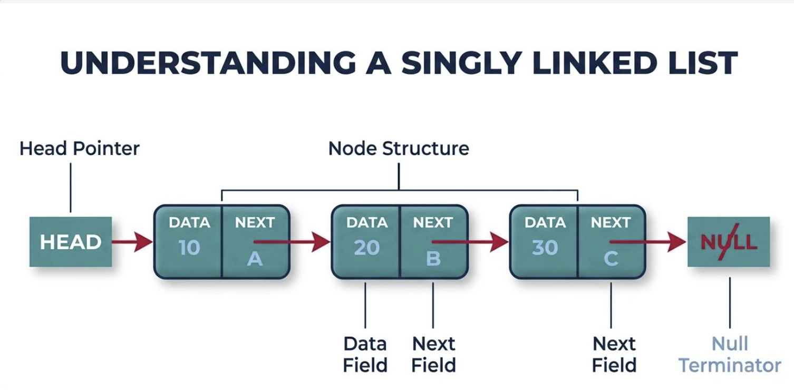
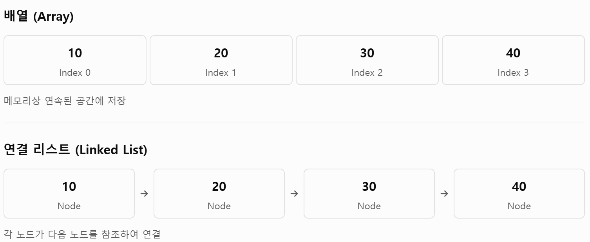
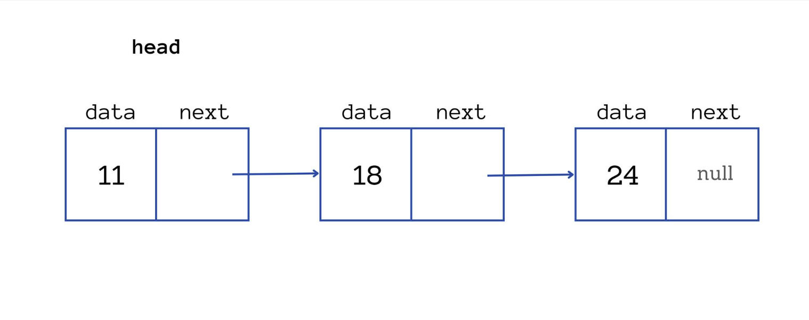
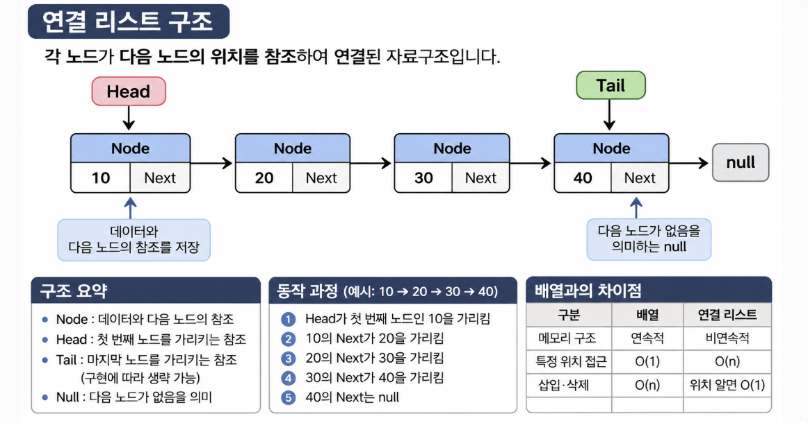

## 3.1 연결 리스트란?

연결 리스트는 각 데이터가 다음 데이터의 위치를 참조하여 연결되는 자료구조이다.



배열과 달리 데이터가 메모리상에 연속적으로 저장될 필요가 없다.

각 데이터 요소를 **노드(Node)** 라고 하며, 노드는 일반적으로 데이터와 다음 노드를 가리키는 참조로 구성된다.

### 노드의 구성

- **Data**: 실제 저장할 데이터
- **Next**: 다음 노드의 참조(주소)

마지막 노드의 Next는 다음 노드가 없다는 의미로 `null`을 가리킨다.

### 배열과 연결 리스트 비교



| 구분 | 배열(Array) | 연결 리스트(Linked List) |
|---|---|---|
| 메모리 구조 | 연속적 | 비연속적 |
| 데이터 접근 | 인덱스 사용 | 순차 탐색 |
| 특정 위치 접근 | O(1) | O(n) |
| 삽입·삭제 | 일반적으로 O(n) | 위치를 알고 있다면 O(1) |
| 크기 | Java 배열은 고정 | 동적으로 변경 가능 |

## 3.2 연결 리스트의 구조



연결 리스트는 첫 번째 노드를 가리키는 Head를 기준으로 각 노드가 연결된다.

- **Head**: 첫 번째 노드를 가리키는 참조
- **Node**: 데이터와 다음 노드의 참조를 저장
- **Tail**: 마지막 노드
- **Null**: 다음 노드가 없음을 의미

예를 들어 `10 → 20 → 30`이라는 연결 리스트가 있다면 다음과 같이 동작한다.

1. Head가 첫 번째 노드인 10을 가리킨다.
2. 10의 Next가 20을 가리킨다.
3. 20의 Next가 30을 가리킨다.
4. 30의 Next는 null이다.

※ Tail은 구현에 따라 마지막 노드를 가리키는 참조를 별도로 보관할 수도 있다.

## 3.3 연결 리스트의 주요 연산

| 연산 | 시간 복잡도 | 설명 |
|---|---|---|
| 첫 번째 노드 접근 | O(1) | Head를 통해 접근 |
| 특정 값 탐색 | O(n) | 처음부터 순차 탐색 |
| 인덱스 접근 | O(n) | 원하는 위치까지 이동 |
| 맨 앞 삽입 | O(1) | Head 변경 |
| 맨 앞 삭제 | O(1) | Head를 다음 노드로 변경 |
| 맨 뒤 삽입 | O(n) | Tail이 없으면 마지막까지 탐색 |
| 중간 삽입 | O(n) | 삽입할 위치 탐색 필요 |
| 중간 삭제 | O(n) | 삭제할 노드의 이전 노드 탐색 필요 |

### 삽입과 삭제의 시간 복잡도

연결 리스트에서 삽입과 삭제 자체는 O(1)이 될 수 있다.

하지만 해당 위치를 찾는 과정까지 포함하면 O(n)이 될 수 있다는 점이 중요하다.

예를 들어 중간 위치에 노드를 삽입하려면 먼저 삽입할 위치까지 이동해야 한다. 위치를 이미 알고 있다면 실제 연결 변경은 O(1)이다.

## 3.4 Java로 연결 리스트 구현하기

### 1) Node 클래스 구현

Node 클래스는 데이터와 다음 노드의 참조를 저장한다.

```java
class Node {
    int data;
    Node next;

    Node(int data) {
        this.data = data;
        this.next = null;
    }
}
```

### 2) 노드 연결하기

```java
public class Main {
    public static void main(String[] args) {

        Node first = new Node(10);
        Node second = new Node(20);
        Node third = new Node(30);

        // 노드 연결
        first.next = second;
        second.next = third;

        // 연결 리스트 순회
        Node current = first;

        while (current != null) {
            System.out.println(current.data);
            current = current.next;
        }
    }
}
```

실행 결과:

```text
10
20
30
```

### 핵심 코드 설명

```java
current = current.next;
```

현재 노드에서 다음 노드로 이동한다.

`current`가 `null`이 될 때까지 반복하면 연결 리스트의 모든 노드를 순회할 수 있다.

## 3.5 연결 리스트의 장단점

### 장점

- 데이터 삽입과 삭제가 유리한 구조를 만들 수 있다.
- 배열처럼 미리 크기를 지정할 필요가 없다.
- 메모리 공간을 비연속적으로 활용할 수 있다.

### 단점

- 인덱스를 통한 빠른 접근이 불가능하다.
- 원하는 데이터를 찾으려면 순차 탐색이 필요하다.
- 데이터 외에 다음 노드의 참조를 저장할 추가 공간이 필요하다.

