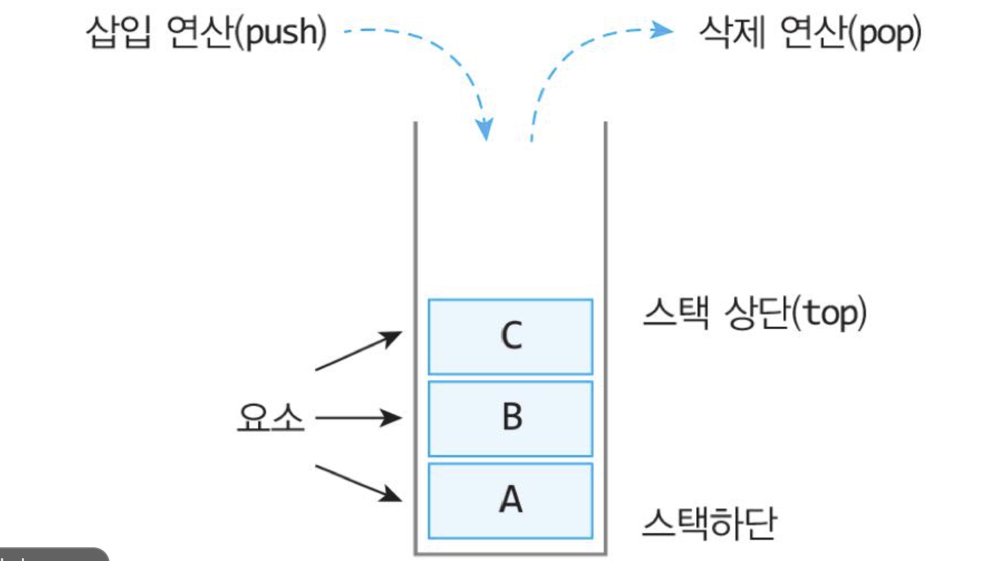
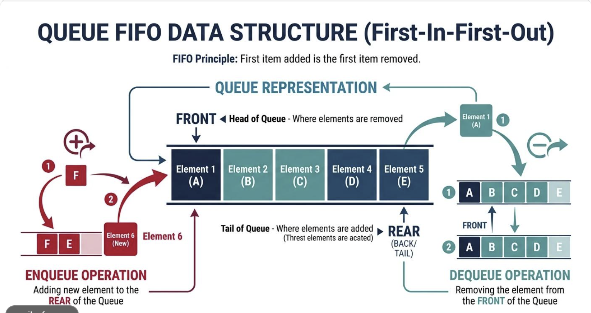
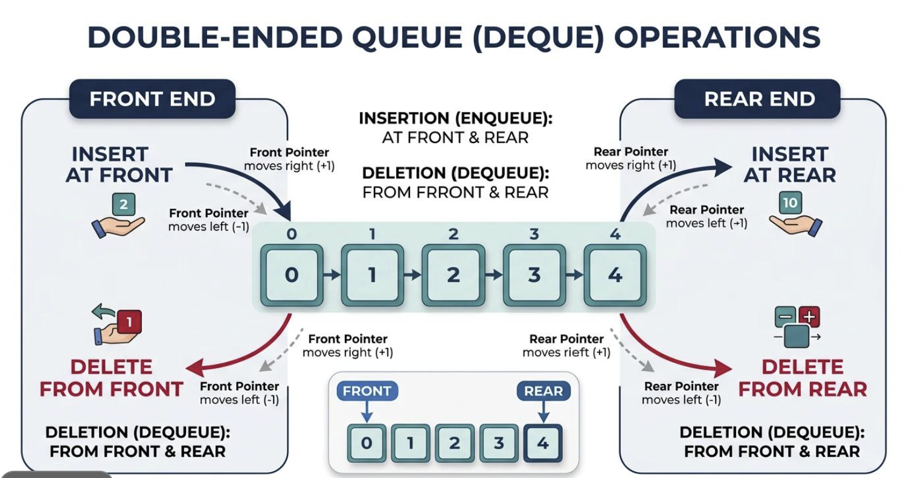

## 4.1 스택(Stack)

**스택(Stack)**은 데이터를 한쪽 끝에서만 삽입하고 삭제하는 자료구조다.

가장 나중에 들어온 데이터가 가장 먼저 나가는 **LIFO(Last In, First Out)** 구조를 가진다.




### 1. 스택의 기본 구조

스택은 책을 쌓아 올리는 모습과 비슷하다.

- 가장 위에 있는 데이터부터 꺼낼 수 있다.
- 아래에 있는 데이터를 꺼내려면 위에 있는 데이터부터 제거해야 한다.

예를 들어 다음과 같이 데이터를 삽입한다고 생각해 보자.

```text
Push(10)
Push(20)
Push(30)
```

스택의 상태:

```text
    TOP
   ┌────┐
   │ 30 │ ← 마지막에 삽입
   ├────┤
   │ 20 │
   ├────┤
   │ 10 │ ← 처음 삽입
   └────┘
```

데이터를 꺼내면 `30 → 20 → 10` 순서로 제거된다.

### 2. 스택의 주요 연산

| 연산 | 설명 | 시간 복잡도 |
|---|---|---|
| Push | 데이터 삽입 | O(1) |
| Pop | 최상단 데이터 삭제 및 반환 | O(1) |
| Peek | 최상단 데이터 확인 | O(1) |
| isEmpty | 스택이 비어 있는지 확인 | O(1) |
| Size | 저장된 데이터 개수 확인 | O(1) |

- **Push**: 스택의 가장 위에 데이터를 추가한다.
- **Pop**: 스택의 가장 위에 있는 데이터를 제거하고 반환한다.
- **Peek**: 데이터를 제거하지 않고 가장 위에 있는 데이터만 확인한다.

### 3. Java에서 스택 사용하기

Java에서는 `Deque` 인터페이스와 `ArrayDeque` 구현체를 사용하여 스택을 구현하는 것을 권장한다.

```java
import java.util.ArrayDeque;
import java.util.Deque;

public class StackExample {

    public static void main(String[] args) {

        Deque<Integer> stack = new ArrayDeque<>();

        // 데이터 삽입
        stack.push(10);
        stack.push(20);
        stack.push(30);

        // 가장 위에 있는 데이터 확인
        System.out.println(stack.peek());

        // 데이터 제거
        System.out.println(stack.pop());
        System.out.println(stack.pop());

        // 남은 데이터 개수
        System.out.println(stack.size());
    }
}
```

실행 결과:

```text
30
30
20
1
```

**주의할 점**

- `pop()`은 데이터를 제거하고 반환한다.
- `peek()`은 데이터를 제거하지 않고 반환한다.
- 빈 스택에서 `pop()`이나 `peek()`을 호출하면 `NoSuchElementException`이 발생한다.

### 4. 스택의 활용 사례

- **함수 호출 관리**: 함수가 호출되고 종료되는 순서를 관리한다.
- **괄호 검사**: 괄호의 열림과 닫힘이 올바른지 확인한다.
- **실행 취소(Undo)**: 가장 최근에 수행한 작업부터 취소한다.
- **뒤로 가기**: 방문 기록을 역순으로 되돌아간다.
- **DFS**: 깊이 우선 탐색에서 탐색 순서를 관리한다.

---

## 4.2 큐(Queue)

**큐(Queue)**는 먼저 들어온 데이터가 먼저 나가는 자료구조다.



**FIFO(First In, First Out)** 구조를 가진다.

### 1. 큐의 기본 구조

큐는 줄을 서서 기다리는 모습과 비슷하다.

- 먼저 줄을 선 사람이 먼저 서비스를 받는다.
- 나중에 줄을 선 사람은 뒤에서 기다린다.

예를 들어 다음과 같이 데이터를 삽입한다고 생각해 보자.

```text
Enqueue(10)
Enqueue(20)
Enqueue(30)
```

큐의 상태:

```text
FRONT                 REAR
  ↓                     ↓
┌────┬────┬────┐
│ 10 │ 20 │ 30 │
└────┴────┴────┘
  ↓
삭제되는 방향
```

데이터를 꺼내면 `10 → 20 → 30` 순서로 제거된다.

### 2. 큐의 주요 연산

| 연산 | 설명 | 시간 복잡도 |
|---|---|---|
| Enqueue | 데이터 삽입 | O(1) |
| Dequeue | 가장 먼저 들어온 데이터 삭제 및 반환 | O(1) |
| Peek | 가장 앞에 있는 데이터 확인 | O(1) |
| isEmpty | 큐가 비어 있는지 확인 | O(1) |
| Size | 저장된 데이터 개수 확인 | O(1) |

- **Enqueue**: 큐의 뒤쪽에 데이터를 추가한다.
- **Dequeue**: 큐의 앞쪽에서 데이터를 제거하고 반환한다.
- **Peek**: 큐의 앞쪽 데이터를 제거하지 않고 확인한다.

### 3. Java에서 큐 사용하기

Java에서는 `Queue` 인터페이스와 `ArrayDeque` 구현체를 사용할 수 있다.

```java
import java.util.ArrayDeque;
import java.util.Queue;

public class QueueExample {

    public static void main(String[] args) {

        Queue<Integer> queue = new ArrayDeque<>();

        // 데이터 삽입
        queue.offer(10);
        queue.offer(20);
        queue.offer(30);

        // 가장 앞에 있는 데이터 확인
        System.out.println(queue.peek());

        // 데이터 제거
        System.out.println(queue.poll());
        System.out.println(queue.poll());

        // 남은 데이터 개수
        System.out.println(queue.size());
    }
}
```

실행 결과:

```text
10
10
20
1
```

**주의할 점**

| 메서드 | 설명 |
|---|---|
| offer() | 데이터 삽입 |
| poll() | 데이터 제거 및 반환 |
| peek() | 가장 앞의 데이터 확인 |

- `poll()`과 `peek()`은 큐가 비어 있으면 `null`을 반환한다.
- `remove()`는 빈 큐에서 호출하면 예외가 발생한다.

### 4. 큐의 활용 사례

- **작업 스케줄링**: 먼저 요청된 작업부터 처리한다.
- **프린터 대기열**: 먼저 요청한 인쇄 작업부터 처리한다.
- **메시지 처리**: 메시지를 순서대로 처리한다.
- **BFS**: 너비 우선 탐색에서 탐색 순서를 관리한다.
- **운영체제**: 프로세스 및 작업 대기열을 관리한다.

---

## 4.3 덱(Deque)

**덱(Deque, Double Ended Queue)**은 양쪽 끝에서 데이터를 삽입하고 삭제할 수 있는 자료구조다.



스택과 큐의 동작을 모두 구현할 수 있다는 특징이 있다.

### 1. 덱의 기본 구조

일반적인 큐는 뒤쪽에서 삽입하고 앞쪽에서 삭제한다.

반면 덱은 앞쪽과 뒤쪽 모두에서 삽입과 삭제가 가능하다.

```text
       FRONT             REAR
         ↓                 ↓
      ┌────┬────┬────┐
      │ 10 │ 20 │ 30 │
      └────┴────┴────┘
        ↕              ↕
     삽입/삭제       삽입/삭제
```

### 2. 덱의 주요 연산

| 연산 | 설명 | 시간 복잡도 |
|---|---|---|
| addFirst | 앞쪽에 데이터 삽입 | O(1) |
| addLast | 뒤쪽에 데이터 삽입 | O(1) |
| removeFirst | 앞쪽 데이터 삭제 | O(1) |
| removeLast | 뒤쪽 데이터 삭제 | O(1) |
| peekFirst | 앞쪽 데이터 확인 | O(1) |
| peekLast | 뒤쪽 데이터 확인 | O(1) |

### 3. Java에서 덱 사용하기

Java에서는 `Deque` 인터페이스와 `ArrayDeque` 구현체를 사용한다.

```java
import java.util.ArrayDeque;
import java.util.Deque;

public class DequeExample {

    public static void main(String[] args) {

        Deque<Integer> deque = new ArrayDeque<>();

        // 앞쪽에 삽입
        deque.addFirst(10);

        // 뒤쪽에 삽입
        deque.addLast(20);
        deque.addLast(30);

        // 앞쪽 데이터 확인
        System.out.println(deque.peekFirst());

        // 뒤쪽 데이터 확인
        System.out.println(deque.peekLast());

        // 앞쪽 데이터 삭제
        System.out.println(deque.removeFirst());

        // 뒤쪽 데이터 삭제
        System.out.println(deque.removeLast());
    }
}
```

실행 결과:

```text
10
30
10
30
```

### 4. 덱의 활용 사례

- **슬라이딩 윈도우**: 특정 구간의 최댓값이나 최솟값을 효율적으로 관리한다.
- **양방향 작업 처리**: 앞뒤 양쪽에서 작업을 추가하거나 제거한다.
- **팰린드롬 검사**: 문자열의 앞과 뒤 문자를 비교한다.
- **스택과 큐 구현**: 양쪽 끝을 활용해 두 자료구조의 동작을 구현한다.

---

## 4.4 스택, 큐, 덱 비교

| 구분 | Stack | Queue | Deque |
|---|---|---|---|
| 데이터 삽입 | 한쪽 끝 | 뒤쪽 | 양쪽 |
| 데이터 삭제 | 한쪽 끝 | 앞쪽 | 양쪽 |
| 처리 방식 | LIFO | FIFO | 양방향 |
| 주요 연산 | Push / Pop | Enqueue / Dequeue | Add / Remove |
| 활용 사례 | 함수 호출, DFS | 대기열, BFS | 슬라이딩 윈도우 |

### 핵심 정리

- **Stack**: 마지막에 들어온 데이터가 먼저 나간다. (LIFO)
- **Queue**: 처음에 들어온 데이터가 먼저 나간다. (FIFO)
- **Deque**: 앞과 뒤 양쪽에서 데이터를 삽입하고 삭제할 수 있다.
- 적절한 구현을 사용하면 세 자료구조의 주요 삽입·삭제 연산을 O(1)에 수행할 수 있다.

### Java 자료구조 선택

| 자료구조 | Java 구현 | 특징 |
|---|---|---|
| Stack | ArrayDeque | 스택으로 사용하는 것을 권장 |
| Queue | ArrayDeque | 일반적인 큐 구현 |
| Deque | ArrayDeque | 양쪽 끝에서 삽입·삭제 가능 |

※ Java의 기존 `Stack` 클래스도 사용할 수 있지만, 일반적인 스택 구현에는 `Deque`와 `ArrayDeque` 조합을 권장한다.

### 기억해야 할 핵심

- 스택은 LIFO, 큐는 FIFO 구조다.
- 덱은 양쪽 끝에서 삽입과 삭제가 가능하다.
- 스택의 주요 연산은 Push와 Pop이다.
- 큐의 주요 연산은 Enqueue와 Dequeue이다.
- BFS는 큐, DFS는 스택을 대표적으로 사용한다.