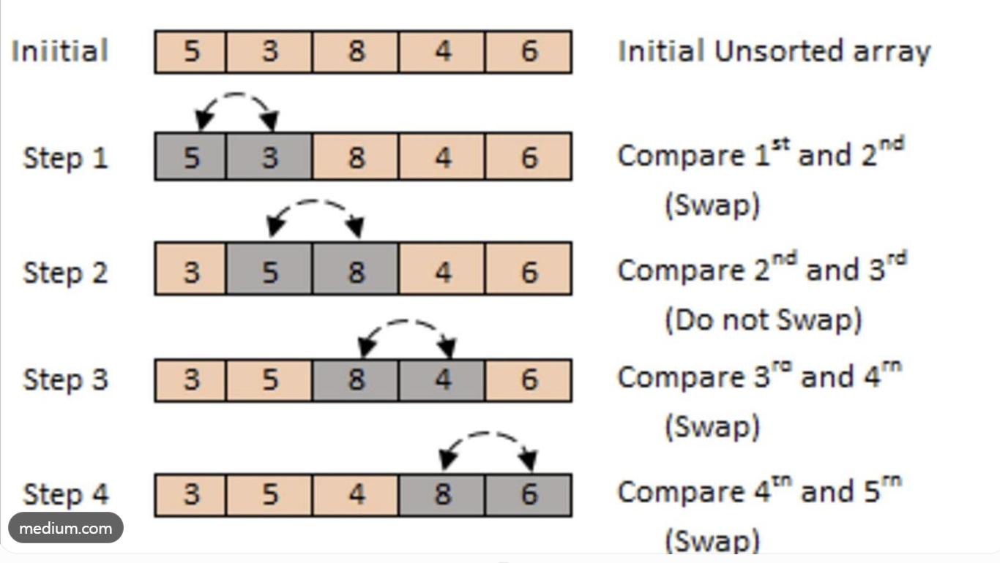

## 5.4 정렬 (Sorting)

정렬(Sorting)은 데이터를 특정한 기준에 따라 순서대로 나열하는 작업이다.

데이터를 정렬하면 탐색과 데이터 관리가 쉬워진다.

### 1. 정렬의 종류

#### 오름차순과 내림차순

| 구분 | 설명 | 예시 |
|---|---|---|
| 오름차순 | 작은 값부터 큰 값 순서 | 1, 2, 3, 4, 5 |
| 내림차순 | 큰 값부터 작은 값 순서 | 5, 4, 3, 2, 1 |

#### 안정 정렬 (Stable Sort)

값이 같은 데이터들의 기존 순서가 정렬 후에도 유지되는 정렬이다.

예를 들어 학생의 점수를 기준으로 내림차순 정렬한다고 가정하자.

```text
정렬 전
철수(90점) → 영희(80점) → 민수(90점)

안정 정렬 후
철수(90점) → 민수(90점) → 영희(80점)
```

철수와 민수의 점수가 같으므로 기존 순서가 유지된다.

#### 제자리 정렬 (In-place Sort)

정렬 과정에서 별도의 추가 메모리를 거의 사용하지 않고 원본 데이터 내부에서 정렬하는 방식이다.

- 추가 메모리 사용량이 적다.
- 원본 배열의 데이터 위치가 변경된다.

---

## 5.5 버블 정렬 (Bubble Sort)

### 1. 개념

버블 정렬은 **인접한 두 데이터를 비교하여 순서가 잘못되어 있으면 서로 교환하는 정렬 알고리즘**이다.

오름차순 정렬에서는 큰 값이 배열의 뒤쪽으로 이동하며, 한 회차가 끝날 때마다 가장 큰 값이 마지막 위치에 확정된다.

### 2. 동작 원리

다음 배열을 오름차순으로 정렬한다고 가정한다.

```text
[5, 3, 8, 1, 2]
```

1회차: 인접한 두 값을 비교하고 큰 값을 뒤로 이동시킨다.

```text
5와 3 비교 → 교환
[3, 5, 8, 1, 2]

5와 8 비교 → 교환하지 않음
[3, 5, 8, 1, 2]

8과 1 비교 → 교환
[3, 5, 1, 8, 2]

8과 2 비교 → 교환
[3, 5, 1, 2, 8]
```

1회차가 끝나면 가장 큰 값인 `8`이 마지막 위치에 확정된다.

이후 정렬이 완료된 영역을 제외하고 같은 과정을 반복한다.

```text
초기 배열: [5, 3, 8, 1, 2]

1회차:     [3, 5, 1, 2, 8]
2회차:     [3, 1, 2, 5, 8]
3회차:     [1, 2, 3, 5, 8]
4회차:     [1, 2, 3, 5, 8]

정렬 완료: [1, 2, 3, 5, 8]
```


### 3. Java 구현

```java
import java.util.Arrays;

public class BubbleSort {

    public static void sort(int[] arr) {

        for (int i = 0; i < arr.length - 1; i++) {

            for (int j = 0; j < arr.length - 1 - i; j++) {

                if (arr[j] > arr[j + 1]) {
                    int temp = arr[j];
                    arr[j] = arr[j + 1];
                    arr[j + 1] = temp;
                }
            }
        }
    }

    public static void main(String[] args) {
        int[] arr = {5, 3, 8, 1, 2};

        sort(arr);

        System.out.println(Arrays.toString(arr));
        // [1, 2, 3, 5, 8]
    }
}
```

### 4. 코드 핵심

| 코드 | 역할 |
|---|---|
| 바깥쪽 반복문 | 정렬 회차 관리 |
| 안쪽 반복문 | 인접한 데이터 비교 |
| `arr[j] > arr[j + 1]` | 앞의 값이 더 크면 교환 |
| `arr.length - 1 - i` | 정렬이 완료된 뒤쪽 영역 제외 |
| `temp` | 두 데이터의 위치 교환을 위한 임시 변수 |

### 5. 시간 복잡도

| 경우 | 시간 복잡도 | 설명 |
|---|---|---|
| 최선 | O(n²) | 기본 구현 기준 |
| 평균 | O(n²) | 반복적인 비교와 교환 |
| 최악 | O(n²) | 역순으로 정렬된 데이터 |

기본 구현은 이미 정렬된 배열이어도 모든 비교 과정을 수행한다.

다만 `swapped` 변수를 사용하면 교환이 한 번도 발생하지 않은 경우 반복문을 종료할 수 있다.

```java
public static void sort(int[] arr) {

    for (int i = 0; i < arr.length - 1; i++) {

        boolean swapped = false;

        for (int j = 0; j < arr.length - 1 - i; j++) {

            if (arr[j] > arr[j + 1]) {
                int temp = arr[j];
                arr[j] = arr[j + 1];
                arr[j + 1] = temp;

                swapped = true;
            }
        }

        // 교환이 없었다면 이미 정렬된 상태
        if (!swapped) {
            break;
        }
    }
}
```

개선된 버전의 시간 복잡도는 다음과 같다.

| 경우 | 시간 복잡도 |
|---|---|
| 최선 | O(n) |
| 평균 | O(n²) |
| 최악 | O(n²) |

### 6. 버블 정렬의 특징

| 구분 | 내용 |
|---|---|
| 정렬 방식 | 인접한 데이터 비교 및 교환 |
| 평균 시간 복잡도 | O(n²) |
| 최악 시간 복잡도 | O(n²) |
| 최선 시간 복잡도 | 기본 구현 O(n²), 개선 구현 O(n) |
| 공간 복잡도 | O(1) |
| 안정 정렬 | O |
| 제자리 정렬 | O |

- 구현이 간단하다.
- 추가 메모리 사용량이 적다.
- 데이터가 많으면 성능이 좋지 않다.
- 정렬의 기본 원리를 이해하기 좋은 알고리즘이다.